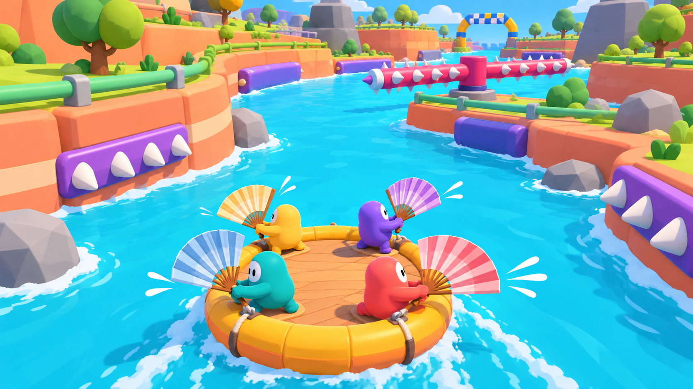

# Bad at Boating — fan raft redesign

22 October2026 · **R1 local playable feel slice implemented; [graphics/teaching improvement passes](GAME_POLISH_PHASES.md) active. Human/art acceptance and the complete course remain open.**

The owner's latest screenshots and request change the product direction to a bright toy-like cooperative raft obstacle game. This document takes precedence over older paddle/realism design assumptions. The default entry is now the fan raft slice, fan protocol1 / fan-raft-0.2 / toy-bend-1. The wooden-boat prototype remains at `/legacy.html`; its evidence does not verify this redesign. [R1 implementation batch](FAN_RAFT_IMPLEMENTATION.md) · [Landing and four dividers](FAN_LANDING.md) · [Release/coasting correction](FAN_COASTING.md).

## Plan for this design batch

| Step | Files | Change | Risk / recovery |
|---|---|---|---|
| 1 | FAN_RAFT_REBOOT.md | Research, screenshot analysis, control proposal, physics contract, course and phase checklist | Separate observed reference details from proposed mechanics; unresolved choices remain explicit |
| 2 | PRODUCTION_PLAN.md, STATUS.md, PRD_PROGRESS.md | Put the new direction before legacy implementation history | Preserve historical evidence; do not relabel old work as new acceptance |
| 3 | PRODUCTION_TRACKER.json, scripts/tracker.mjs | Display a prominent redesign notice and link; identify the old ledger as historical | Keep all existing dependencies/evidence and generation rules intact |
| 4 | Tracker tests and generated reports | Verify notice, escaping, link, search and regeneration | Correct a failed check before reporting this batch complete |
| 5 | assets/fan-raft-direction-v1.png, FAN_RAFT_CONCEPT_PROMPT.txt | Save an original generated art-direction frame and its exact prompt | Label it concept art; it is not a runtime capture or collision-layout proof |

Decision: implement a documented design revision and tracker notice first. Reuse the existing engine, networking and onboarding; add no runtime dependency or speculative framework. The first runtime batch will test fan handling and toy art together in a small course before replacing the full map.

Historical R0 contract: the initial design batch delivered the analysis and tracked migration without a runtime change. R1 implementation followed the owner's explicit request to start work; the separate implementation record distinguishes its scope and verification.

## 1. What the reference establishes

The owner's four screenshots are the visual reference. They establish visible shapes, camera composition and hazard design, not the exact input mapping or underlying simulation.

| Visible feature | Why it works | Our direction |
|---|---|---|
| Bright cyan water with short white wake marks | Raft silhouette and route stay easy to read | Opaque stylized water, modest waves, clear contact foam and directional wake |
| Coral/orange block cliffs and green tubular edges | The course reads as a constructed toy obstacle world | Rounded banks, large clean colour areas, restrained scenery, our own shapes/palette |
| Purple bars with oversized white teeth | Dangerous surfaces can be recognized by shape as well as colour | Repeated tooth language on dangerous rails, gates and sweepers |
| Chunky gray rocks and simple tree crowns | Large readable silhouettes without fine texture noise | Few well-shaped props; put detail into animation, spacing and shadows |
| Circular raft and four strongly coloured characters | Shared vehicle and individual ownership are immediately visible | Original round raft, four compact characters, matching oversized folding fans |
| Raised three-quarter camera | Turns and moving obstacles are visible before contact | Stable course-facing chase camera with forward look-ahead and phone framing |
| Huge start/checkpoint gates and route chevrons | Progress is visible inside the world | Clear safe recovery pools, generous checkpoint arches, sparse UI |
| Narrow passages, bends and a cross-channel moving hazard | Timing, braking and coordination matter | Teach one rule safely, test it, then combine it with a known rule |

The official [Fart Together Steam page](https://store.steampowered.com/app/5117550/Fart_Together/) describes 2–4 players steering a shared raft through narrow passages, turns and moving obstacles through coordinated direction and timing. It does not establish a particular Space/A/D mapping. The owner's description is the source for that desired simplicity. Our fan control and course proposals below are our design, not claims about the reference implementation.

The desired quality comes from a coherent art direction, readable motion and responsive play. Increasing reflection passes, geological detail or wood grain would not address this request. We will use our own fans, characters, world and obstacle layouts.

## 2. Game identity and loop

**Four friends on one round raft, waving comically oversized hand fans to survive a colourful obstacle course.** Every fan stroke has an obvious air direction; the raft reacts in the opposite direction. Success requires deciding who pushes, who brakes and who waits.

Loop: open invite → confirm name → join the live animated raft lobby → Ready/tick → short safe fan lesson → obstacle sequence → checkpoint celebration → harder combination → finish/time summary → retry or another course. Retain “You” on the local character and entered names on the other three.

The fan is the main visual gag: a large folding leaf/shell fan, a quick anticipation pose, a decisive flap, two or three short air streaks and a soft recovery wobble. A held input repeats complete flaps; it does not create a continuous invisible engine. Empty seats do not fan by themselves in the four-player mode.

## 3. Proposed controls — one action, small adjustment

**Owner confirmed in this conversation:** A/D slides the player a small distance left/right; Space operates a large funny hand fan. Use left/right arrows as aliases. This is a small local movement, not free walking, direct raft steering or unlimited orbiting. Touch gets a large Fan button and two small scoot buttons. Rebinding must preserve the same semantics. Station layout, movement range and tuning still need the playable slice.

| Input | Proposed behaviour | Boundary |
|---|---|---|
| Space press | Begin one fan stroke with immediate visible anticipation and a short power phase | Server owns stroke phase and power; OS key repeat cannot add strokes |
| Space hold | Repeat at a fixed readable cadence | No mash bonus, charge meter or stamina system in the first slice |
| Space release | Finish the current bounded stroke; do not begin another | Blur, pause and disconnect clear the repeat request and require neutral rearm |
| A/D or left/right | Slide along the station's tangent, initially about ±0.25 m for a roughly 4 m raft | Speed/position bounded by the server; no instant pose jump or direct yaw command |
| Menu/retry | Existing menu and shared checkpoint retry | No hidden additional steering controls |

The fan's airflow keeps the station's outward direction while the player scoots sideways. Its line of action therefore moves away from the raft centre. If the fan were re-aimed exactly through the centre after every scoot, the turning effect would disappear. The visual fan, air streaks and force must agree.

Initial trial values, **not approved tuning**: 0.7 s full stroke cycle, power beginning within 0.1 s, roughly 0.2–0.35 s power phase. Compare the actual feel before committing. Fan-angle adjustment is not the selected control; do not add it on top of the confirmed small player movement.

## 4. Physics contract and the important traps

Use one authoritative dynamic round raft body. Keep fixed-step simulation and the existing server authority. Apply each short horizontal fan-force envelope at its actual attachment point. Rapier already supports [forces and impulses at a point](https://rapier.rs/docs/user_guides/javascript/rigid_bodies/#forces-and-impulses); a new physics engine is unnecessary.

For a fan air direction **d**, raft reaction is **F = −strength × d**. Turning follows **torque = (attachment − centre of mass) × F**. A centred radial push translates but produces no yaw. Tangential scooting creates a signed lever arm; opposite scoots should reverse the yaw contribution. Rotate both the attachment and force consistently with the raft pose.

Use inertia, current-relative drag and yaw damping to settle the raft. Fan Camp now defaults to still water so releasing all fans coasts to rest; surface animation supplies no permanent downstream propulsion. Explicitly authored future current zones must visibly communicate their force. Braking comes from opposite fan forces and water drag. Ordinary wall contacts slide/bounce through the solver. Keep gentle physical heave/roll with a stable centre of mass; fan input stays horizontal. Rendering can exaggerate fan flex, avatar reaction and tube squash without inventing movement authority. This is a consistent stylized reaction-force game, not a claim that a real handheld fan could power a loaded raft this effectively.

Two opposing fans can cancel translation. All four equal radial forces can cancel altogether; with offset attachments they can still create a spin. This must be visible and taught in the safe pool. We should not add an invisible forward boost to hide cancellation, nor count a cancelled motion as an input failure.

Fixed outward stations also risk making three players idle on a long straight. Address that in the course: short straights, bends that change the raft's orientation, braking gates, lateral dodge sequences and visible current. Observe actual four-human participation. If one seat dominates, revise the station/aim design before making more levels. Decorative obstacles alone cannot fix a weak cooperative loop.

There is no extra thrust from tapping faster, sending extra packets, higher refresh rate, holding through reconnect or translating the character alone. Use the existing ownership, finite-number, stale-input and bounded catch-up protections. Recheck all of them against the new fan payload. Remove the old automatic straight-row assist, blade-water/contact logic and W/S forward/reverse semantics from the new mode rather than layering fan input on top of them.

Required proof for the first fan slice: every seat pushes opposite its visible air, equal opposites cancel, centered pushes have negligible yaw, opposite scoots reverse yaw, changing heading rotates the same response, release/pause clears repetition, and simultaneous four-seat input remains bounded. Include actual Rapier contacts, not just vector-helper tests.

## 5. Art direction and browser budget

Original concept generated with the built-in Imagegen tool. Exact prompt: [FAN_RAFT_CONCEPT_PROMPT.txt](FAN_RAFT_CONCEPT_PROMPT.txt). This establishes the intended colourful toy feeling and oversized folding fans, not final assets, material settings, station geometry, obstacle clearance or verified performance. Build the real scene in native Three.js geometry; do not use this image as a substitute for gameplay.

The raft should read as a round toy: thick coloured flotation rim, a simple deck, chunky grab straps and four distinct stations. Avoid the old long hull, fine plank construction and paddle silhouettes. Characters should have readable large heads, small limbs and clear fan poses. Their colour identity must also have a shape/marker cue.

Water: blue/cyan base, broad slow surface movement, short layered white wake strokes, contact foam and restrained sparkle. Default away from full-scene reflection/refraction passes. Foam follows actual velocity/contacts; it should not imply forward travel when the raft is stationary. Background scenery stays quieter than the raft and hazards.

Terrain: smooth block cliffs, broad colour bands, rounded course rails and a small family of chunky trees/rocks. One soft sun shadow and ambient fill are a starting point. Trial simple lit materials against the intended look; “toon” in a material name does not guarantee the right result or a speed improvement. Use merged or instanced repeated props with existing Three.js facilities; no custom asset framework.

Camera: follow course progress more than raft yaw so a spinning raft does not spin the whole screen. Smooth turns without hiding their exits. Look ahead at least several raft lengths, then tune to braking distance and moving-hazard speed. Test portrait separately: widen the view or adapt camera distance rather than clipping the next decision. Names/Ready markers must not obstruct incoming hazards.

Provisional **measurement targets**, not current results: visible gameplay geometry under 250k triangles, under 150 draw calls including shadows, one shadow-casting sun, no dynamic mirror pass; local main-thread p95 under 4 ms and GPU p95 under 10 ms at 1080p on a recorded reference device. Confirm or adjust these targets through measured capture, including four clients. Lower Graphics must preserve every obstacle, warning, motion phase and collision rule. Do not trade readability for a counter.

Audio should make actions understandable: soft fan whoosh at the power phase, rubber bump, distinctive spike puncture, moving-hazard warning and a short checkpoint cue. Keep all four fans distinguishable without filling the mix with continuous noise.

## 6. Obstacle language and first catalogue

Proposed rule change for the toy raft: **plain surfaces bump; visibly toothed/spiked surfaces fail the raft.** This differs from the previous lethal-rock design and remains a design proposal until reviewed. A plain gray rock must not secretly have the old lethal collider. A dangerous rock needs the same visible tooth treatment as other lethal hazards. Retain a quick shared checkpoint retry rather than starting the entire course over.

| Obstacle | Teach / challenge | Readable construction |
|---|---|---|
| Soft bumper bend | Learn momentum and outside-wall slide | Thick rounded harmless rail, no teeth |
| Offset tooth rails | Coordinate lateral correction without panic | Alternating magenta bars, large ivory teeth, safe middle line |
| Rotating spiked sweeper | Wait, brake, then commit | Visible hub/arm, open sweep area, repeatable motion |
| Sliding gate pair | Stop drifting while a safe gap opens | Clearly separated gate panels and a waiting pocket |
| Foam punching arm | Bump and recover before drifting into teeth | Rounded padded end, anticipation pose, swept impact path |
| Rock slalom | Plan a line instead of reacting late | Few large clean rocks, generous first pass, tighter remix |
| Side wind tunnel | Counter a force with the correct crew | Visible giant fan prop, streamers and spray showing direction |
| Gentle whirlpool bowl | Manage curved current and escape timing | Broad spiral surface cues, safe teach version first |
| Split route | Choose safe-wide or risky-short together | Both routes visible before committing; shared checkpoint exit |
| Final combined gate | Test already learned timing and corrections | No new hidden hazard in the finale |

Begin with bend, tooth rails and sweeper in the feel slice. Add the remaining families only after that loop is enjoyable. Hazards need collider/visual agreement and actual swept-volume checks at the maximum reachable speed. Moving hazards use shared simulation time and a room seed. Safe openings must fit the raft plus correction margin; do not choose random positions independently.

Randomness belongs in curated variants: alternate safe lanes, bounded mover phase patterns, optional safe/risky branches and cosmetic dressing. Generate/check a reachable combination first. Preserve the room's variant through retry/reconnect so learning remains useful. Never spawn a fresh lethal surprise inside the camera's reaction window or place hazards on a checkpoint spawn.

## 7. First complete course and later levels

The initial **60–90 second feel-slice target** relied on downstream current. After owner feedback requiring natural coast-to-rest, the156 m still-water slice takes145.433 seconds in the synthetic pilot. Human pacing must be remeasured. It contains a launch pool, one open turn, an offset-tooth passage, a safe waiting pocket, one sweeper and a checkpoint/finish gate. It must demonstrate the intended toy art at ordinary gameplay distance and run with four real browser clients. This is a test course, not the promised complete map.

Then author **one complete course targeting 4–4.5 minutes of clean active play**, measured with a coordinated human crew. Retries, lobby time and forced waiting cannot be padding. Map length in metres alone does not establish gameplay duration. Newcomer attempts will normally take longer; record both rather than promising an exact finish time for everyone.

| Proposed beat | Target clean traversal | Purpose |
|---|---|---|
| Fan camp / launch pool | 0:00–0:30 | Teach opposite push, cancellation and scoot turning safely |
| Coral bends | 0:30–1:10 | Bump rails, rock slalom, first teeth, checkpoint |
| Toy workshop | 1:10–1:55 | Sweeper and sliding gates with waiting pockets |
| Wind garden | 1:55–2:40 | Side gusts, split route, checkpoint relief |
| Rapids ribbon | 2:40–3:25 | Visible current plus familiar teeth and timing |
| Carnival finish | 3:25–4:15 | Combine known rules, then a generous finish bay |

These times are pacing hypotheses, not observations. Adjust route distance, current, gaps and encounter spacing after measured traversal. Relief after each difficult sequence matters as much as adding another obstacle.

Later course candidates: a pastel beach waterpark, a windmill toy workshop and a candy-coloured canyon. Each should add one meaningful mechanic using the same readable obstacle vocabulary. The old fourteen region cards and eighty concepts remain a historical idea catalogue; they are not fourteen accepted levels or an automatic obligation to import every old hazard into this redesign. Final breadth remains a scope discussion after the first course proves the loop.

## 8. Reuse, replace and migration

| Keep as a starting point, then reverify | Replace for the new direction |
|---|---|
| Three.js, Rapier, Colyseus and fixed server stepping | Long wooden boat and detailed paddle/shaft/blade machinery |
| Invite → name confirmation → assigned seat → Ready ticks | Four-direction rowing input and straight-row assistance |
| Shared pause, input freshness and reconnect ownership | Physics geometry/mass tuning for the round raft and fan forces |
| Checkpoint storage integrity, lease and conflict protections | Old route coordinates, hazard choreography and photoreal terrain/water priorities |
| Local browser fixtures, instrumentation and repeatable QA methods | Paddle-only tests and legacy capsize prompts as fan acceptance criteria |

Introduce a new physics/world identity when the fan mode becomes playable. Reject incompatible clients clearly. Preserve old saves under their old identity; do not silently reinterpret an old checkpoint index as a location in the new course. Any offered restart must be explicit. Test same-world reconnect separately from old-world save handling.

The localhost default now runs the new slice. Existing `?crew=` links belong to the legacy room; the new mode uses `?raft=` and rejects old save tokens. The existing deployment archive remains historical until explicitly rebuilt. Historical source/build fingerprints remain historical; current slice artifacts and checks have separate evidence. No public deployment is implied.

## 9. New delivery tracker

Statuses below describe this redesign only. No old PASS count transfers automatically. The existing production dashboard links here and labels its prior ledger as legacy.

| Phase | Status | Deliverable | Exit gate |
|---|---|---|---|
| R0 — design direction | CONTROLS CONFIRMED; ART REVIEW OPEN | This analysis, confirmed A/D + Space controls, concept frame, art/collision language, migration and first-course plan | Owner art/feel feedback still needed |
| R1 — fan feel + toy slice | IMPLEMENTED; LOCAL QA; HUMAN GATE OPEN | Round raft, four fans, ±0.28 m player slide, real forces/buoyancy, new camera/art and 156 m course with one checkpoint | Scoped physics/network/native checks recorded; four-human feel session and named-device timing remain |
| R2 — complete first course | NOT STARTED | All six beats, checkpoints, safe variants, finish/retry | Observed 4–4.5 minute clean traversal target; newcomer route/readability notes; fair gaps and recoveries |
| R3 — multiplayer and polish | NOT STARTED | Final fan/crew animation, sounds, touch, persistence migration, onboarding | No stale/forged thrust; shared mover phase; latency/reconnect/save tests; measured browser/device budgets |
| R4 — additional levels and release | NOT STARTED | Accepted extra course scope, varied themes, release package | Each course playtested; named-device/Internet/long-session checks; complete release acceptance |

R1 checklist; controls are confirmed and implementation checks remain pending:

- [x] Owner confirms small A/D player movement and Space for a large funny fan; no additional aim control.
- [x] Create round raft collision/mass model and four visible fan stations (280 kg cylinder, nine buoyancy probes).
- [x] Implement server-owned bounded fan strokes, hold cadence and neutral rearm.
- [x] Verify opposite thrust, cancellation, offset torque and heading consistency in actual physics.
- [x] Replace the old rowing UI/input semantics in the new mode.
- [x] Deliver initial toy raft, original avatars/fans, bright water and chunky course kit at gameplay distance; owner art approval remains open.
- [x] Validate camera framing at six authored poses in desktop, portrait and landscape; human obstacle-readability remains open.
- [x] Build launch pool, bend, tooth passage, waiting pocket, sweeper and checkpoint.
- [x] Define/verify plain bump versus visible-spike failure, including moving contact and predictive near misses.
- [x] Exercise four clients, name/You labels, Ready, pause/rejoin and new world/save identity; durable fan saves remain R3.
- [ ] Complete named-device frame/CPU/GPU budgets and full High/Low parity. Scoped counters and initial Low view exist; they are not full timing acceptance.
- [ ] Observe four people playing; record who understands push/turn/brake and whether every seat contributes.

The current R1 course pilot traverses the still-water slice through four actual simulated fan inputs in145.433 simulated seconds without teleport/reset; all four stations contribute. The initial0.1 build's83.55-second result is historical. That proves synthetic reachability, not four-human enjoyment or the complete-game duration. R2 still targets a measured4–4.5 minute complete course. Fan/crew animation is an initial flap/air/lean pass; final sound, remapping/controller migration, durable saves, broader random variants, additional levels, Internet/long-session and human/device acceptance remain open.

## Historical R0 design-batch verification

Observed 21 October 2026:

- `npm run tracker` and `npm run tracker:check`: PASS, 49 legacy deliverables + 90 content tasks, 2/100 legacy accepted scope points; dependency/evidence/report checks passed.
- `node --test tests/tracker.test.mjs`: tests 2, pass 2, fail 0. Includes direction-link validation and escaping alongside existing completion/dependency guards.
- `node tests/tracker-browser.mjs`: PASS, Chrome 155.0.8059.82, seven checks, errors `[]`. New direction notice and document link visible; earlier phases explicitly historical; existing filters remain usable. Screenshot inspected at the top of the page. Record: `evidence/tracker-browser.json`.
- Two local design links resolve; concept has a valid PNG signature and was visually inspected. It contains four characters with oversized folding fans, a round raft and the intended colourful course language.

Runtime tests/build were not rerun for this documentation/tracker batch. No fan gameplay verification is claimed. **VERDICT: PASS for the design-batch checks above.**
